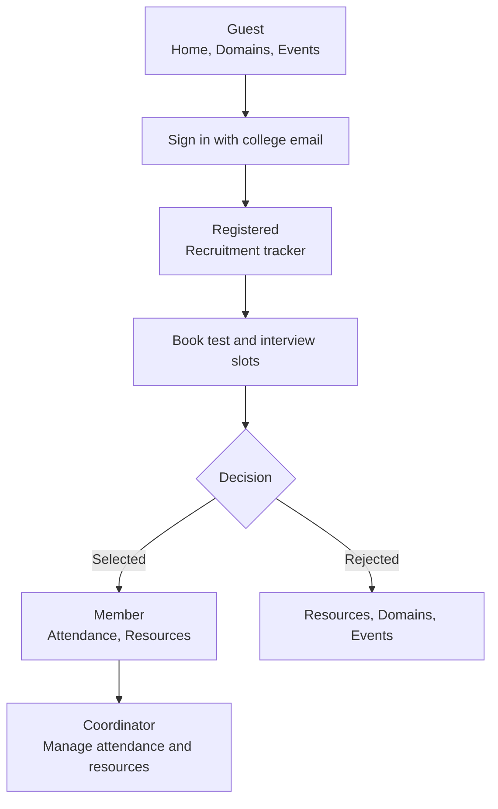
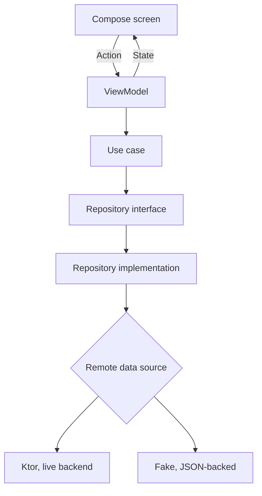

<div align="center">

# Innogeeks

**The Android app for the InnoGeeks technical club at KIET.**


</div>

## Table of contents

- [Why Innogeeks](#why-innogeeks)
- [How it works](#how-it-works)
- [Features](#features)
- [Tech stack](#tech-stack)
- [Architecture](#architecture)
- [Engineering highlights](#engineering-highlights)
- [Getting started](#getting-started)
- [Testing](#testing)
- [Project structure](#project-structure)
- [Status and roadmap](#status-and-roadmap)
- [Author](#author)

## Why Innogeeks

A student club runs on scattered tools. Recruitment lives in forms and chat groups, attendance on paper, and learning material in links nobody can find. Applicants wait for days without knowing where they stand.

Innogeeks puts the whole club in one app. Anyone can browse it as a guest. After signing in with a college email, the app changes with the user's role: applicant, member or coordinator.

## How it works

A user starts as a guest and moves through the club's recruitment pipeline. The app reshapes its tabs at each step.



[](https://github.com/mahakaal2005/InnogeeksApp/raw/main/videos/Guest_Demo.mp4)

## Features

| Feature | What it does |
|---|---|
| Guest browsing | Home with a bento-grid hero, club stats, achievements carousel and class-culture photo stack. No login needed. |
| Domains | A domain wheel for App Dev, Web, ML, IoT and AR/VR. Each domain has a detail page with its 2026-27 coordinators and team. |
| Events | The club's dated event history with a sliding detail page and zoomable photos. |
| College-email sign-in | Email check, verification code, password setup, login and password reset. |
| Recruitment tracker | Shows progress through fee, test, interview and decision, including waitlisted and rejected outcomes. |
| Slot booking | Pick or change test and interview slots from a bottom sheet. |
| Member home and profile pass | A dashboard for members, and a profile pass showing role and assigned domain. |
| Attendance (member) | Recent sessions, month groups, unmarked sessions and an attendance percentage. |
| Attendance (coordinator) | Create sessions and mark the roster. |
| Resources | 250 curated learning resources. The list opens on the member's own domain. |
| Resource editing (coordinator) | Add, edit and remove the domain's resources, with undo. |
| Account | Edit name and phone, log out (the token is revoked on the server), and request account deletion. |

The bottom tabs depend on the signed-in role:

| Role | Tabs |
|---|---|
| Guest | Home, Domains, Events, Profile |
| Registered | Tracker, Domains, Resources, Events, Profile |
| Registered (rejected) | Resources, Domains, Events, Profile |
| Member, Coordinator, Admin | Home, Attendance, Resources, Profile |

## Tech stack

| Layer | Technology |
|---|---|
| Language | Kotlin 2.3.20 |
| UI | Jetpack Compose (BOM 2026.06.01), Material 3, Haze 2.0.0-alpha03 for blur, Lottie 6.6.2 |
| Navigation | Navigation Compose 2.8.4 with type-safe `@Serializable` routes |
| Dependency injection | Koin 4.0.0 |
| Networking | Ktor Client 3.0.1 (OkHttp engine), kotlinx.serialization 1.7.3 |
| Local storage | Jetpack DataStore Preferences 1.1.1, JSON files for demo data |
| Async and dates | Kotlin Coroutines and Flow 1.9.0, kotlinx-datetime 0.6.1 |
| Build | Android Gradle Plugin 9.3.2, Gradle 9.5.0, min SDK 24, target SDK 36, compile SDK 37 |
| Tests | JUnit 4.13.2, Compose UI test, Espresso |

## Architecture

The app is a single Gradle module (`:app`) organised as feature-driven Clean Architecture. Each feature has its own `domain`, `data` and `presentation` packages. The presentation layer uses MVI: a screen sends one **Action** to its ViewModel, the ViewModel exposes one immutable **State**, and one-shot **Events** (navigation, snackbars) go through a separate channel.



- The domain layer has no Android imports and never depends on data or presentation.
- Features never import each other. Shared contracts live in `core/`.
- Data returns `Result<D, DataError>`. The ViewModel unpacks it into flat state, and a mapper turns each error into a string resource.
- Loading is a plain `isLoading` flag in state, not part of `Result`.

## Engineering highlights

- **One session flow drives the whole app.** A `Session` is either `Guest` or `Authenticated(role, domain)`. The tab set and the Resources start domain come from it, so a role change re-renders the shell without a re-login.
- **Fake and live data sources share one interface.** Auth, profile and recruitment call the live backend. Attendance and resources run on fakes behind the same `*RemoteDataSource` interface, and the Ktor versions are already written. Going live is a one-line change in each Koin module. The fakes persist to a JSON file, so demo edits and undo state survive a restart.
- **Dead tokens sign the user out.** The HTTP client treats a 401 on a request that carried a token as an expired session and drops the user to guest mode. The bearer plugin re-reads storage on refresh, because the cached token can be `null` right after login.
- **Request bodies never reach Logcat.** Logging is capped at headers in debug builds and is off in release. Bodies would expose passwords, verification codes and tokens.
- **Resource content is checked by a test.** The 250 resources ship as a JSON asset. A unit test asserts 10 items per domain and type, and that every id and URL is unique, so a bad edit to the file fails the build.

## Getting started

### Prerequisites

- Android Studio (a recent stable release)
- JDK 17 or newer
- An emulator or device on Android 7.0 (API 24) or higher

### Clone

```bash
git clone https://github.com/mahakaal2005/InnogeeksApp.git
cd InnogeeksApp
```

### Configure the backend

The backend is not part of this repository. Add its URL to `local.properties` in the project root. The file is gitignored.

```properties
apiBaseUrl=https://your-backend-host
```

If the key is missing, the app falls back to a placeholder host. Guest browsing and the fake-backed features still work, but sign-in and the recruitment tracker will fail.

### Run and build

```bash
./gradlew installDebug      # build and install on a connected device or emulator
./gradlew assembleDebug     # build the debug APK only
./gradlew bundleRelease     # build a minified release bundle (unsigned)
```

You can also open the project in Android Studio, let Gradle sync, and run the `app` configuration. The release build has no signing config, so add your own before publishing.

## Testing

```bash
./gradlew testDebugUnitTest         # JVM unit tests
./gradlew connectedDebugAndroidTest # instrumented tests, needs a device or emulator
```

The unit tests cover the resource mapper, the bundled resources asset and the user-domain mapping. The instrumented suite only holds the default example test. ViewModels and repositories have no tests yet.

Known issue: `ResourceMapperTest` still passes an `emoji` argument that `ResourceDto` no longer has, so `testDebugUnitTest` currently fails to compile until that test is updated.

## Project structure

```text
app/src/main/
├── assets/resources.json        # 250 curated learning resources
├── res/                         # strings, fonts, Lottie animation
└── java/com/example/innogeeks/
    ├── InnogeeksApp.kt          # Application, assembles Koin modules
    ├── MainActivity.kt          # single activity
    ├── shell/                   # role-aware bottom navigation, nav graph
    ├── core/
    │   ├── domain/              # Result, DataError, Session, UserRole, UserDomain
    │   ├── data/                # HttpClientFactory, safeCall, session store, fake store
    │   ├── navigation/          # shared routes
    │   └── presentation/        # glass components, UiText, ObserveAsEvents
    ├── feature_onboarding/      # splash, intro, email gate, login, password setup and reset
    ├── feature_recruitment/     # journey tracker, slot picker
    ├── feature_home/            # guest home, member dashboard
    ├── feature_domains/         # domain wheel and detail
    ├── feature_events/          # event list and detail
    ├── feature_resources/       # domain picker, browser, detail, coordinator editing
    ├── feature_attendance/      # member attendance, coordinator manager
    ├── feature_profile/         # profile pass, edit, logout, account deletion
    └── ui/theme/                # dark-only theme and typography
```

## Status and roadmap

The app is in active development and currently at version 4.1.0. The UI is dark mode only.

| Area | State |
|---|---|
| Guest browsing: home, domains, events | Done |
| Authentication and password reset | Done, on the live backend |
| Recruitment tracker, slot booking, profile | Done, on the live backend |
| Attendance and resources, member and coordinator | Built on fake data |
| Connect attendance and resources to live endpoints | Planned, waiting on the backend |
| Admin surface | Planned. Admins see the coordinator tabs for now. |
| Tests for ViewModels and repositories | Planned |

## Author

Built by [Atul Kumar Singh](https://github.com/mahakaal2005).
